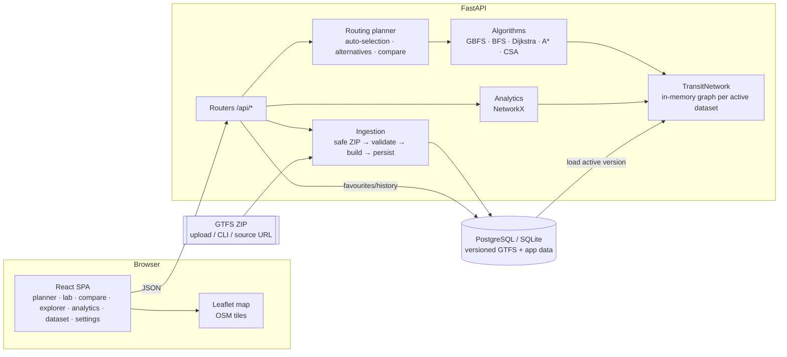
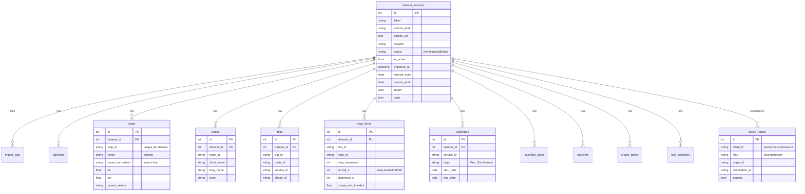

# Architecture

## System overview

- **Ingestion** never extracts to disk. `archive.py` reads members in memory after rejecting absolute
  paths, `..` segments, duplicate files, oversized archives and suspicious compression ratios.
- **Validation** (`parser.py`) drops and *reports* duplicates, unknown references, bad coordinates,
  invalid sequences, untimed or backwards stop times, and orphan parent stations. Nothing is
  interpolated or invented.
- **Persistence** is per `DatasetVersion`. An import writes a new version in one transaction and only
  then flips `is_active`. Rollback re-activates an older valid version. If building the graph for a
  newly activated version fails, the previous version is restored.
- **The in-memory network** is rebuilt from the database at startup and on activation (about 0.4 s for
  the DMRC feed), and cached per process.

## Graph model

| Structure | Kind | Used by | Why |
|---|---|---|---|
| Station graph | directed simple graph; edge = consecutive stops on ≥1 trip; per-edge `route_id → scheduled seconds`, track distance, straight-line distance | BFS, GBFS, distance/stops objectives, analytics, alternatives | Directed because service patterns can be one-way. A simple graph keeps BFS/GBFS identical to their textbook form. Line information is kept in the per-route time table, so it is never lost. |
| Route-aware state space | implicit multigraph: states `(station, route, k)` while riding, `(station, None, k)` between trains | Dijkstra / A* for time, transfers, balanced | Makes train changes explicit costs, so transfer counting and limits are exact. `k` counts changes and is tracked only when a transfer limit is set. |
| Connections | list of `(dep_stop, arr_stop, dep, arr, trip, route, service)` sorted by departure | Connection Scan | Timetable routing in one linear scan. |

Rules derived from the data, never assumed:

- An edge exists only if some trip serves u then v **consecutively**. Ids, names and geography are
  never used to infer adjacency.
- A station = a stop, or its `parent_station` when the feed groups platforms.
- Edge time = median over trips of *arrival(v) − arrival(u)* for that route. It includes dwell at u,
  so chained edges add up to the scheduled journey time.
- Track distance = median `shape_dist_traveled` difference. The unit is inferred from its ratio to
  straight-line distance (≈1 → metres, ≈0.001 → km). Values shorter than the straight line are
  rejected, and the edge then uses a straight-line estimate flagged `straight_line_estimate`.
- Lines = route variants grouped by `METROMIND_LINE_GROUP_PATTERN`, a regex on `route_long_name`
  (DMRC: `RED_Rithala to Dilshad Garden`). A **transfer** is any train change. A **line change** is a
  change between line groups. Both are reported.

## Algorithms

All search algorithms run on a `SearchSpace` protocol (`start`, `neighbors`, `is_goal`, `heuristic`,
`geo_km`, `add`, `zero`). That makes them independent of GTFS and testable on tiny graphs. Each run can
record a bounded **trace** (`expand`, `discover`, `update`, `goal` events with g/h/f and a top-k
frontier snapshot). Recording stops at `METROMIND_TRACE_MAX_EVENTS` and is flagged as truncated; the
search itself always completes.

| Algorithm | Frontier | Optimality | Time | Space |
|---|---|---|---|---|
| Greedy Best-First (`gbfs.py`) | min-heap on h(n) = straight-line km | none (ignores g) | O(E log V) with the discovered set | O(V) |
| BFS (`bfs.py`) | FIFO | fewest edges | O(V + E) | O(V) |
| Dijkstra (`dijkstra.py`) | min-heap on g(n), lazy deletion | optimal for non-negative (incl. lexicographic) weights | O((V + E) log V) | O(V) |
| A* (`astar.py`) | min-heap on f = g + h, ties to larger g | optimal if h is admissible and consistent | O((V + E) log V) worst case | O(V) |
| CSA (`csa.py`) | — (linear scan) | earliest arrival | O(#connections) | O(stops + trips) |

**A\* heuristic.** h(n) = c · straight_line_m(n, goal), where
c = min over all edges of (edge cost ÷ edge straight-line metres). By the triangle inequality,
c · d(n, g) ≤ c · d(n, m) + c · d(m, g) ≤ w(n, m) + h(m). So h is consistent, and therefore admissible,
in the objective's own units: seconds for time, metres for distance, (0, seconds) for the lexicographic
transfers objective, and minutes + stop-weight × hops for balanced (hops lower-bounded by
d ÷ longest single hop). Negative or NaN weights raise an error.

**GBFS caveat.** It expands whatever looks geographically closest and never revisits a decision. On the
DMRC network it matched the optimum on 60 % of 30 random pairs, with gaps up to 66 % (see the analytics
benchmark).

**Multi-criteria.** No units are mixed silently. Time adds an explicit transfer allowance. Transfers
is lexicographic. Balanced is "generalised minutes" with user-set weights that are echoed in every
result.

**Alternatives.** Candidate station paths come from Yen's k-shortest simple paths (NetworkX, bounded
by count and a 2 s budget) plus the fewest-transfers route. Each is re-costed under the objective;
duplicates and paths sharing more than 80 % of edges with an already chosen route are dropped.

**Schedule-aware (CSA).** Active services for the query date come from `calendar.txt` and
`calendar_dates.txt`. Connections from the previous service day are shifted by −24 h, so trips
timetabled at 24:00+ serve the early hours, and the next day is shifted by +24 h. Staying on a trip
needs no slack. Changing trips needs `min_transfer_time` (from transfers.txt) or the configured
minimum. Dates outside the calendar are refused with the nearest valid same-weekday date.

**Automatic selection.** Departure time given and timetable available → CSA. Stops objective → BFS.
Coordinates and a positive heuristic factor → A*. Otherwise → Dijkstra. The reason is returned to the
user.

## Database schema

Indexes: `(dataset_id, stop_id)` unique, `(dataset_id, name_normalized)`,
`(dataset_id, trip_id, stop_sequence)`, `(dataset_id, route_id)`, `(dataset_id, shape_id, sequence)`.
Migrations are managed by Alembic (`backend/alembic`) and run on startup (`METROMIND_AUTO_MIGRATE`).
The same migration produces valid PostgreSQL DDL (`alembic upgrade head --sql`).

## Security

- Admin endpoints need `Authorization: Bearer <METROMIND_ADMIN_TOKEN>` (constant-time compare). They
  are disabled entirely when no token is configured. The browser keeps the token in `sessionStorage`
  only.
- ZIP safety: in-memory reading, path-traversal and bomb checks, size limits (`METROMIND_MAX_UPLOAD_MB`,
  `METROMIND_MAX_UNCOMPRESSED_MB`). Downloads use http(s) only, with a size cap.
- All queries go through the SQLAlchemy ORM / Core with bound parameters. Station ids are pattern-
  validated by Pydantic.
- Structured errors `{"error": {code, message, details}}`. Unhandled exceptions are logged
  server-side and returned without stack traces or paths.
- CORS allow-list, per-IP rate limit, request validation, search timeouts, gzip.
- Favourites and history are keyed by an anonymous random client id. There are no accounts and no
  passwords.
